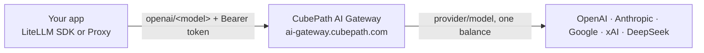

# Use LiteLLM with the CubePath AI Gateway

Connect [LiteLLM](https://github.com/BerriAI/litellm) to the [CubePath AI Gateway](https://cubepath.com/ai-gateway) to call OpenAI, Anthropic, Google, xAI and DeepSeek models with one API token and one balance, from the LiteLLM Python SDK or the LiteLLM Proxy.

**Base URL:** `https://ai-gateway.cubepath.com/v1` · **Tested with:** LiteLLM 1.110.3 · **Last updated:** November 2026

> **New to CubePath?** [Create an account](https://my.cubepath.com) and generate an API token to follow this guide. Full reference in the [AI Gateway docs](https://cubepath.com/docs/products/deployment/ai-gateway).



## Overview

The **CubePath AI Gateway** is a single endpoint that serves models from several providers. It speaks the OpenAI Chat Completions API and the native Anthropic Messages API, so existing SDKs work by changing the base URL. Requests are authenticated with a CubePath API token and billed per token from your organization balance.

**LiteLLM** is an open-source Python SDK and proxy server (LLM gateway) that exposes 100+ model providers through the OpenAI input/output format. It adds retries, fallbacks, virtual keys, spend tracking and logging on top of any provider.

Because the AI Gateway is OpenAI-compatible, LiteLLM connects to it through its built-in **OpenAI-compatible route** (`openai/` prefix plus a custom `api_base`). No plugin or fork is required.

| Property             | Value                                                                       |
|----------------------|-----------------------------------------------------------------------------|
| Base URL             | `https://ai-gateway.cubepath.com/v1`                                        |
| Authentication       | `Authorization: Bearer <CUBEPATH_API_KEY>`                                  |
| LiteLLM route        | `openai/<cubepath-model-id>` with `api_base` set to the base URL            |
| Model ID format      | `provider/model`, for example `anthropic/claude-sonnet-5`                   |
| Supported operations | Chat completions (sync, async, streaming), tool calling, Anthropic Messages |
| Not supported        | OpenAI Responses API (`/v1/responses`)                                      |
| Default rate limit   | 60 requests per minute per organization                                     |

> [!NOTE]
> CubePath is not yet a native LiteLLM provider. This guide uses LiteLLM's generic OpenAI-compatible provider, which works with any current LiteLLM release.

## Why use LiteLLM with the AI Gateway

The two tools cover different layers, so they complement each other instead of overlapping:

| Layer           | CubePath AI Gateway                                                                           | LiteLLM                                                                |
|-----------------|-----------------------------------------------------------------------------------------------|------------------------------------------------------------------------|
| Provider access | One token and one prepaid balance for OpenAI, Anthropic, Google, xAI and DeepSeek             | Uses the gateway as one upstream                                       |
| Billing         | Per-token billing at catalog prices, usage per day and per model for 30 days in the dashboard | Optional per-key, per-team and per-user spend tracking and budgets     |
| Reliability     | Returns provider errors with retry hints (`Retry-After`)                                      | Automatic retries, model fallbacks, timeouts, rate-limit aware routing |
| Access control  | Token scopes, IP allowlist, organization roles                                                | Virtual keys for apps and teams, model allowlists per key              |
| Interface       | OpenAI Chat Completions and Anthropic Messages                                                | One OpenAI-format interface for SDK users and proxy clients            |

Typical setups:

- **Application code** that uses the LiteLLM SDK and needs to switch between models from different vendors by changing a string.
- **An internal LLM gateway** (LiteLLM Proxy) that hands out virtual keys to teams while all upstream traffic is billed to a single CubePath balance.
- **Agents and automation tools** that already speak LiteLLM, such as frameworks that accept a LiteLLM model string.

## Prerequisites

- A CubePath account with the **Owner**, **Admin** or **Member** role. Viewers can only list models; the Billing role cannot use the gateway.
- A positive organization balance. The AI Gateway is pay as you go and **promotional credit cannot be used** on it.
- Python 3.10 or later (required by current LiteLLM releases).
- `pip` or `uv`. Docker is optional for running the proxy.

## Get an API token

1.  Sign in to [my.cubepath.com](https://my.cubepath.com) and open the **AI Gateway** page.
2.  Click **Create API Token** and copy the token. Tokens can be limited to specific scopes and pinned to IPs or CIDR ranges; use one token per application so you can revoke it independently.
3.  Click **Add Funds** to top up your balance.
4.  Store the token in an environment variable instead of in code:

```bash
export CUBEPATH_API_KEY="your-cubepath-api-token"
```

Check that the token works by listing the model catalog:

```bash
curl -s https://ai-gateway.cubepath.com/v1/models \
  -H "Authorization: Bearer $CUBEPATH_API_KEY"
```

The response lists every model ID with its price per million input and output tokens, context window, maximum output and capabilities (streaming, vision, tool use).

> [!WARNING]
> Only API tokens are accepted. OAuth tokens return an authentication error.

## Install LiteLLM

Install the SDK:

```bash
pip install litellm
```

If you use the SDK's `num_retries` option (see [Errors and troubleshooting](#errors-and-troubleshooting)), also install `tenacity`, which recent LiteLLM releases do not install by default:

```bash
pip install litellm tenacity
```

Install the proxy server extras if you plan to run the LiteLLM Proxy:

```bash
pip install "litellm[proxy]"
```

## Configure LiteLLM for the AI Gateway

LiteLLM needs three values for every request:

| Parameter  | Value                                | Why                                                                                                                                                            |
|------------|--------------------------------------|----------------------------------------------------------------------------------------------------------------------------------------------------------------|
| `model`    | `openai/` + CubePath model ID        | The `openai/` prefix selects LiteLLM's OpenAI-compatible provider. LiteLLM removes it and sends the rest, such as `anthropic/claude-sonnet-5`, to the gateway. |
| `api_base` | `https://ai-gateway.cubepath.com/v1` | LiteLLM appends `/chat/completions`. The gateway also accepts the URL without `/v1`.                                                                           |
| `api_key`  | Your CubePath API token              | Sent as `Authorization: Bearer <token>`.                                                                                                                       |

A model string has two prefixes on purpose: `openai/anthropic/claude-sonnet-5` means "use the OpenAI-compatible protocol to call the CubePath model `anthropic/claude-sonnet-5`".

You can pass the values per call (recommended) or through the `OPENAI_API_BASE` and `OPENAI_API_KEY` environment variables. Environment variables apply to every `openai/` model in the process, including real OpenAI calls, so prefer explicit parameters when an application talks to more than one OpenAI-compatible endpoint.

## Python SDK examples

### Basic chat completion

```python
import os
import litellm

response = litellm.completion(
    model="openai/anthropic/claude-sonnet-5",  # openai/ + CubePath model ID
    api_base="https://ai-gateway.cubepath.com/v1",
    api_key=os.environ["CUBEPATH_API_KEY"],
    messages=[
        {"role": "system", "content": "You are a concise assistant."},
        {"role": "user", "content": "Explain what a reverse proxy does in two sentences."},
    ],
    temperature=0.2,
    max_tokens=200,
)

print(response.choices[0].message.content)
print(response.usage)  # prompt_tokens, completion_tokens, total_tokens
```

### A reusable helper

Wrap the gateway settings once and switch models by ID:

```python
import os
from functools import partial
import litellm

CUBEPATH_BASE = "https://ai-gateway.cubepath.com/v1"

cubepath_completion = partial(
    litellm.completion,
    api_base=CUBEPATH_BASE,
    api_key=os.environ["CUBEPATH_API_KEY"],
)

def ask(model_id: str, prompt: str) -> str:
    response = cubepath_completion(
        model=f"openai/{model_id}",
        messages=[{"role": "user", "content": prompt}],
        max_tokens=300,
    )
    return response.choices[0].message.content

for model_id in ["openai/gpt-4.1-mini", "anthropic/claude-sonnet-5", "google/gemini-2.5-pro"]:
    print(model_id, "->", ask(model_id, "Name one benefit of hourly billing for a VPS."))
```

### Async requests

```python
import asyncio
import os
import litellm

async def main():
    tasks = [
        litellm.acompletion(
            model=f"openai/{model_id}",
            api_base="https://ai-gateway.cubepath.com/v1",
            api_key=os.environ["CUBEPATH_API_KEY"],
            messages=[{"role": "user", "content": "Summarize Kubernetes in one sentence."}],
            max_tokens=100,
        )
        for model_id in ["openai/gpt-4.1-mini", "anthropic/claude-sonnet-5"]
    ]
    for response in await asyncio.gather(*tasks):
        print(response.model, "->", response.choices[0].message.content)

asyncio.run(main())
```

### Tool calling

The gateway normalizes tool calls across providers. Check the `capabilities` field in `/models` to confirm that a model supports tool use.

```python
import json
import os
import litellm

tools = [{
    "type": "function",
    "function": {
        "name": "get_server_status",
        "description": "Return the status of a server by hostname",
        "parameters": {
            "type": "object",
            "properties": {"hostname": {"type": "string"}},
            "required": ["hostname"],
        },
    },
}]

response = litellm.completion(
    model="openai/openai/gpt-4o",
    api_base="https://ai-gateway.cubepath.com/v1",
    api_key=os.environ["CUBEPATH_API_KEY"],
    messages=[{"role": "user", "content": "Is web-01.example.com up?"}],
    tools=tools,
    tool_choice="auto",
)

for call in response.choices[0].message.tool_calls or []:
    print(call.function.name, json.loads(call.function.arguments))
```

### Reasoning effort

For reasoning models, the gateway accepts `reasoning_effort` with the values `none`, `minimal`, `low`, `medium`, `high`, `xhigh` and `max`. Reasoning tokens are billed as output tokens. LiteLLM forwards the parameter unchanged.

```python
response = litellm.completion(
    model="openai/openai/gpt-4.1-mini",
    api_base="https://ai-gateway.cubepath.com/v1",
    api_key=os.environ["CUBEPATH_API_KEY"],
    messages=[{"role": "user", "content": "Plan a zero-downtime database migration."}],
    reasoning_effort="low",
    stream=True,  # recommended for reasoning models
)
```

## LiteLLM Proxy with config.yaml

The LiteLLM Proxy runs an OpenAI-compatible server in front of the AI Gateway. Clients call the proxy with a LiteLLM key; the proxy calls CubePath with your CubePath token.

### 1. Create config.yaml

```yaml
model_list:
  # Friendly aliases for the models your teams use
  - model_name: claude-sonnet
    litellm_params:
      model: openai/anthropic/claude-sonnet-5
      api_base: os.environ/CUBEPATH_API_BASE
      api_key: os.environ/CUBEPATH_API_KEY

  - model_name: gpt-4o
    litellm_params:
      model: openai/openai/gpt-4o
      api_base: os.environ/CUBEPATH_API_BASE
      api_key: os.environ/CUBEPATH_API_KEY

  - model_name: gemini-pro
    litellm_params:
      model: openai/google/gemini-2.5-pro
      api_base: os.environ/CUBEPATH_API_BASE
      api_key: os.environ/CUBEPATH_API_KEY

  # Optional: expose the whole catalog as cubepath/<provider>/<model>
  - model_name: "cubepath/*"
    litellm_params:
      model: "openai/*"
      api_base: os.environ/CUBEPATH_API_BASE
      api_key: os.environ/CUBEPATH_API_KEY

litellm_settings:
  num_retries: 2
  request_timeout: 600
  # Send /v1/messages traffic to /chat/completions (the gateway has no Responses API)
  use_chat_completions_url_for_anthropic_messages: true

router_settings:
  # If a model fails after retries, try another one
  fallbacks:
    - claude-sonnet: ["gpt-4o"]

general_settings:
  master_key: os.environ/LITELLM_MASTER_KEY
```

### 2. Start the proxy

```bash
export CUBEPATH_API_BASE="https://ai-gateway.cubepath.com/v1"
export CUBEPATH_API_KEY="your-cubepath-api-token"
export LITELLM_MASTER_KEY="sk-$(openssl rand -hex 32)"

litellm --config config.yaml --port 4000
```

> [!NOTE]
> Recent LiteLLM releases refuse to start the proxy without a master key. Set `LITELLM_MASTER_KEY` (or `general_settings.master_key`) before starting it.

### 3. Call the proxy

With cURL:

```bash
curl http://localhost:4000/v1/chat/completions \
  -H "Authorization: Bearer $LITELLM_MASTER_KEY" \
  -H "Content-Type: application/json" \
  -d '{
    "model": "claude-sonnet",
    "messages": [{"role": "user", "content": "Write a haiku about latency."}]
  }'
```

With the OpenAI Python SDK:

```python
import os
from openai import OpenAI

client = OpenAI(base_url="http://localhost:4000", api_key=os.environ["LITELLM_MASTER_KEY"])

response = client.chat.completions.create(
    model="cubepath/deepseek/deepseek-chat",  # wildcard route from config.yaml
    messages=[{"role": "user", "content": "What is BGP anycast?"}],
)
print(response.choices[0].message.content)
```

In production, create virtual keys for each application or team with the proxy's `/key/generate` endpoint instead of sharing the master key. See the [LiteLLM virtual keys documentation](https://docs.litellm.ai/docs/proxy/virtual_keys).

### Optional: cost tracking in LiteLLM

LiteLLM does not know CubePath catalog prices for models on the OpenAI-compatible route, so it reports a cost of 0 by default. To track spend in LiteLLM, copy the per-token prices from `/models` into each model entry:

```yaml
  - model_name: claude-sonnet
    litellm_params:
      model: openai/anthropic/claude-sonnet-5
      api_base: os.environ/CUBEPATH_API_BASE
      api_key: os.environ/CUBEPATH_API_KEY
      input_cost_per_token: 0.000003    # example value: use the /models price ÷ 1,000,000
      output_cost_per_token: 0.000015   # example value
```

The CubePath dashboard remains the source of truth for billing.

## Access different models

Every model is addressed as `provider/model`. To change model, change the string; no other setting changes.

| Provider  | Example CubePath model ID   | LiteLLM model string               |
|-----------|-----------------------------|------------------------------------|
| OpenAI    | `openai/gpt-4.1-mini`       | `openai/openai/gpt-4.1-mini`       |
| Anthropic | `anthropic/claude-sonnet-5` | `openai/anthropic/claude-sonnet-5` |
| Google    | `google/gemini-2.5-pro`     | `openai/google/gemini-2.5-pro`     |
| xAI       | `xai/grok-4-fast`           | `openai/xai/grok-4-fast`           |
| DeepSeek  | `deepseek/deepseek-chat`    | `openai/deepseek/deepseek-chat`    |

The catalog changes as providers release models. Always take IDs from the live catalog:

```python
import os
import httpx

resp = httpx.get(
    "https://ai-gateway.cubepath.com/v1/models",
    headers={"Authorization": f"Bearer {os.environ['CUBEPATH_API_KEY']}"},
    timeout=30,
)
resp.raise_for_status()
for model in resp.json()["data"]:
    print(model["id"])
```

### Alternative: Anthropic models through the Messages API

Anthropic models are also served on the native `/v1/messages` endpoint. To use it from LiteLLM, select LiteLLM's `anthropic/` provider and point it at the gateway **without** `/v1` (LiteLLM adds `/v1/messages`). LiteLLM sends the token in the `x-api-key` header.

```python
response = litellm.completion(
    model="anthropic/claude-sonnet-5",
    api_base="https://ai-gateway.cubepath.com",
    api_key=os.environ["CUBEPATH_API_KEY"],
    messages=[{"role": "user", "content": "Hello"}],
    max_tokens=256,
)
```

Use this route when you need Anthropic-specific features such as prompt caching controls. For everything else, the `openai/` route is simpler and works for every provider.

## Streaming

Streaming is supported for every model that lists streaming in its capabilities. Set `stream=True`:

```python
import os
import litellm

stream = litellm.completion(
    model="openai/anthropic/claude-sonnet-5",
    api_base="https://ai-gateway.cubepath.com/v1",
    api_key=os.environ["CUBEPATH_API_KEY"],
    messages=[{"role": "user", "content": "Write a short checklist to harden an Ubuntu server."}],
    stream=True,
    stream_options={"include_usage": True},  # final chunk carries token usage
)

for chunk in stream:
    if chunk.choices and chunk.choices[0].delta.content:
        print(chunk.choices[0].delta.content, end="", flush=True)
    if getattr(chunk, "usage", None):
        print("\n\nUsage:", chunk.usage)
```

Async streaming:

```python
import asyncio
import os
import litellm

async def main():
    response = await litellm.acompletion(
        model="openai/openai/gpt-4.1-mini",
        api_base="https://ai-gateway.cubepath.com/v1",
        api_key=os.environ["CUBEPATH_API_KEY"],
        messages=[{"role": "user", "content": "Count from 1 to 5."}],
        stream=True,
    )
    async for chunk in response:
        if chunk.choices:
            print(chunk.choices[0].delta.content or "", end="", flush=True)

asyncio.run(main())
```

Streaming through the proxy works the same way: pass `stream=True` to the OpenAI SDK or `"stream": true` in the request body.

**When to stream.** Use streaming for long answers, reasoning models and agents. During reasoning the gateway sends keepalive comments, which LiteLLM and the OpenAI SDK ignore. A non-streaming request that runs longer than 80 seconds receives an HTTP `200` immediately, followed by whitespace every 15 seconds until the answer is ready; if an error happens after that point it arrives in the body with status `200`. Non-streaming requests are cut after 15 minutes, and a provider stream that sends nothing for 300 seconds is closed.

## Errors and troubleshooting

### Status codes and LiteLLM exceptions

LiteLLM maps gateway status codes to typed exceptions, so you can handle them without parsing messages:

| Status        | Meaning on the AI Gateway                                  | LiteLLM exception                                              | What to do                                                   |
|---------------|------------------------------------------------------------|----------------------------------------------------------------|--------------------------------------------------------------|
| `400`         | A feature is not available yet; the body names it          | `BadRequestError`                                              | Remove the parameter or use another model                    |
| `401` / `403` | Invalid token, or with BYOK the provider rejected your key | `AuthenticationError` (401), `APIError` with `status_code` 403 | Check the token, its role and scopes                         |
| `402`         | Balance too low for this request                           | `APIError` (status 402)                                        | Add funds or lower `max_tokens`                              |
| `429`         | Balance held by in-flight requests, or rate limit reached  | `RateLimitError`                                               | Retry after `Retry-After`; lower concurrency or `max_tokens` |
| `503`         | Provider failure, overload or restart                      | `ServiceUnavailableError`                                      | Retry; configure fallbacks                                   |
| `502` / `504` | Network edge could not reach the gateway                   | `BadGatewayError` / `Timeout`                                  | Treat like 503                                               |

Errors from `/chat/completions` have the body `{"detail": "..."}`.

```python
import os
import litellm
from litellm import (
    APIError, AuthenticationError, BadRequestError,
    RateLimitError, ServiceUnavailableError,
)

def safe_completion(model_id: str, messages: list[dict]) -> str | None:
    try:
        response = litellm.completion(
            model=f"openai/{model_id}",
            api_base="https://ai-gateway.cubepath.com/v1",
            api_key=os.environ["CUBEPATH_API_KEY"],
            messages=messages,
            max_tokens=500,
            num_retries=3,     # retries 429/5xx with backoff
            timeout=120,
        )
        return response.choices[0].message.content
    except AuthenticationError:
        raise SystemExit("Invalid CubePath token, or its role cannot use the AI Gateway.")
    except BadRequestError as e:
        print(f"Request not supported by this model: {e.message}")
    except RateLimitError:
        print("Rate limit or balance reservation hit. Retry later or reduce concurrency.")
    except ServiceUnavailableError:
        print("Provider unavailable. Try another model.")
    except APIError as e:
        if e.status_code == 402:
            print("Insufficient balance. Add funds at my.cubepath.com.")
        else:
            raise
    return None
```

Retry behaviour to keep in mind:

- Even without `num_retries`, the underlying OpenAI client retries `429` and `5xx` responses twice, so one call can produce up to three requests.
- `num_retries` retries every error type, including `402`. Keep it low, or catch `402` before retrying, so you don't send repeated requests that cannot succeed.

The gateway does not fail over automatically between providers. To keep an application running when one provider is down, configure LiteLLM fallbacks:

```python
response = litellm.completion(
    model="openai/anthropic/claude-sonnet-5",
    api_base="https://ai-gateway.cubepath.com/v1",
    api_key=os.environ["CUBEPATH_API_KEY"],
    messages=[{"role": "user", "content": "Hello"}],
    fallbacks=["openai/openai/gpt-4o"],
)
```

The fallback model reuses the same `api_base` and `api_key`. In the proxy, use `router_settings.fallbacks` as shown in the config above.

### Common problems

**`LLM Provider NOT provided`, or requests going to the wrong provider**  
The model string is missing the `openai/` prefix. Without it LiteLLM reads the first segment as its own provider: `google/gemini-2.5-pro` fails with this error, while `deepseek/deepseek-chat` or `anthropic/claude-sonnet-5` are sent to DeepSeek's or Anthropic's own APIs instead of the gateway. Always use `openai/<cubepath-model-id>`.

**`404 Not Found`**  
Check that `api_base` is `https://ai-gateway.cubepath.com/v1` and does not include `/chat/completions`. If you call `litellm.responses()`, the gateway does not serve the Responses API: use `litellm.completion()`.

**`401 Unauthorized`**  
The token is wrong, has been revoked, is an OAuth token, belongs to a Viewer or Billing role, or the request comes from an IP outside the token's allowlist.

**`402 Payment Required`**  
The balance cannot cover the input cost plus the maximum output cost. The gateway reserves that amount before running a request, so a large `max_tokens` can trigger 402 even when the real answer would be cheap.

**`429 Too Many Requests` with low traffic**  
Other in-flight requests are holding balance reservations. Lower `max_tokens` or concurrency, or add funds. The default request limit is 60 per minute per organization; set `rpm: 60` in the proxy's `litellm_params` to stay under it.

**Model not found**  
The ID is not in the catalog. List models with `GET /v1/models` and copy the exact ID.

**`/v1/messages` on the proxy fails for `openai/` models**  
By default LiteLLM translates Anthropic Messages requests to the Responses API. Set `use_chat_completions_url_for_anthropic_messages: true` under `litellm_settings`.

**Proxy exits with "no master key is set"**  
Set `LITELLM_MASTER_KEY` before starting the proxy.

**Request body too large**  
The limit is 10 MiB on `/chat/completions` and 32 MiB on `/v1/messages`. Resize images or split the input.

Enable LiteLLM debug logs to see the exact URL, headers (token masked) and body sent to the gateway:

```python
import litellm
litellm._turn_on_debug()
```

## FAQ

**Is CubePath a native LiteLLM provider?**  
Not at the moment. LiteLLM reaches the AI Gateway through its OpenAI-compatible provider: prefix the model with `openai/` and set `api_base` to `https://ai-gateway.cubepath.com/v1`.

**Which LiteLLM functions work with the AI Gateway?**  
`completion()` and `acompletion()`, with or without streaming, including tool calling. `responses()` does not work because the gateway does not serve the OpenAI Responses API. Embeddings are not listed in the AI Gateway documentation.

**Can one LiteLLM Proxy use models from OpenAI, Anthropic and Google with a single key?**  
Yes. Every entry in `model_list` uses the same CubePath token, and all usage is billed to one CubePath balance.

**Does the AI Gateway retry or fail over for me?**  
No. Errors are returned to the client with a status code and, where relevant, a `Retry-After` header. Use LiteLLM's `num_retries` and `fallbacks` to handle them.

**How do I find the price of a model?**  
Call `GET /v1/models`. Each entry includes the price per million input and output tokens.

## Resources

- [CubePath AI Gateway documentation](https://cubepath.com/docs/products/deployment/ai-gateway)
- [CubePath AI Gateway product page](https://cubepath.com/ai-gateway)
- [CubePath API tokens](https://cubepath.com/docs/products/settings/api-tokens)
- [CubePath documentation](https://cubepath.com/docs)
- [LiteLLM documentation](https://docs.litellm.ai/)
- [LiteLLM OpenAI-compatible endpoints](https://docs.litellm.ai/docs/providers/openai_compatible)
- [LiteLLM Proxy configuration](https://docs.litellm.ai/docs/proxy/configs)
- [LiteLLM reliability: retries and fallbacks](https://docs.litellm.ai/docs/proxy/reliability)
- [LiteLLM on GitHub](https://github.com/BerriAI/litellm)
